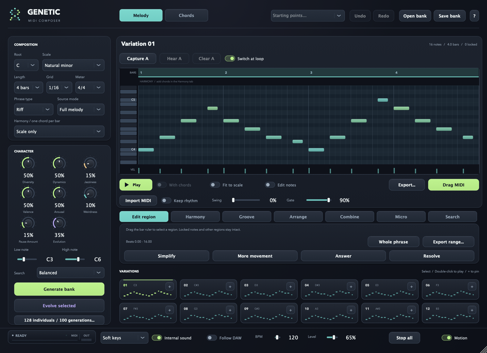
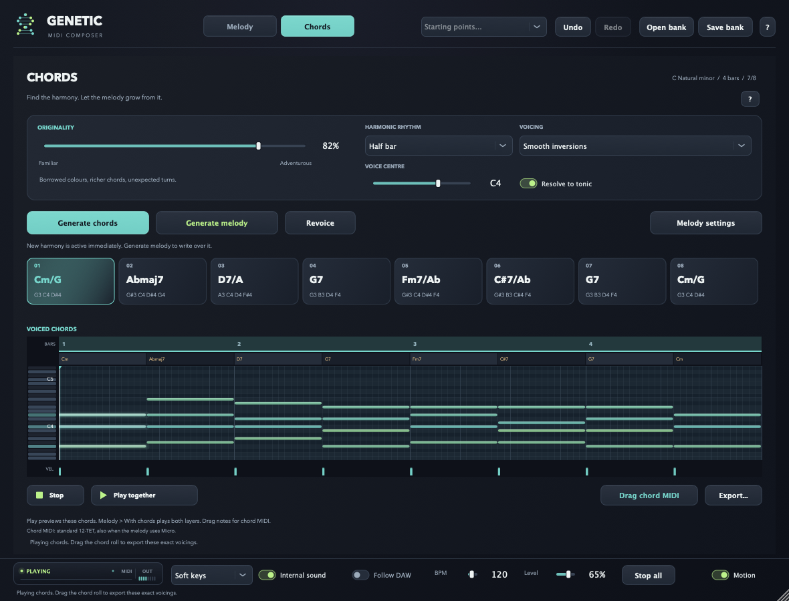
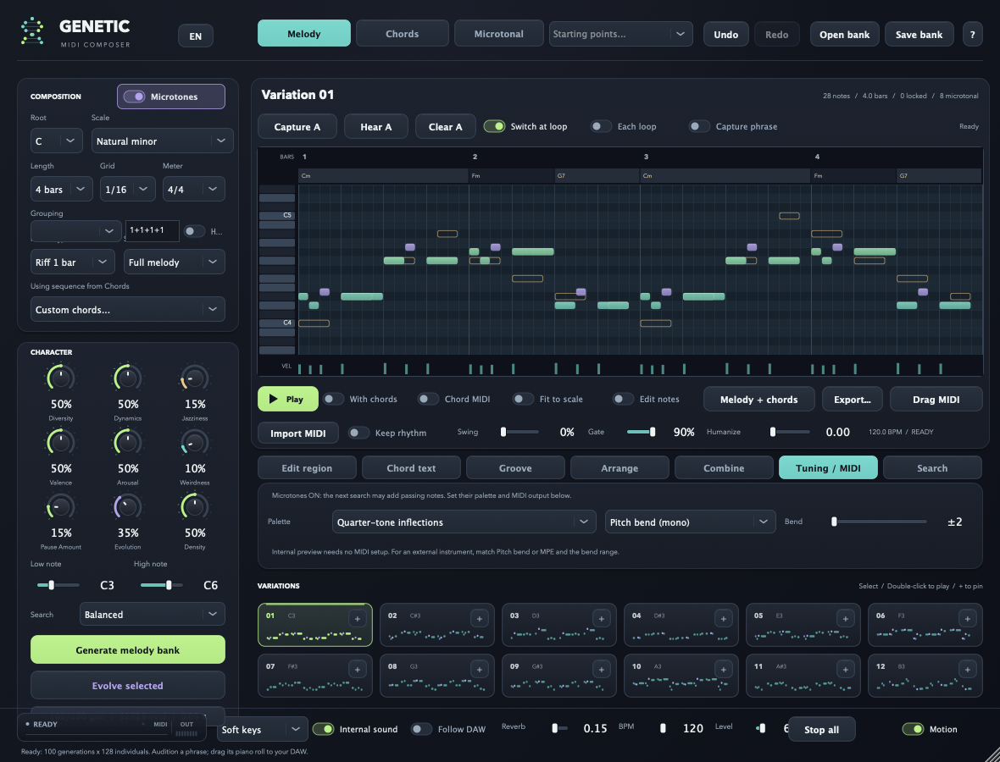

# Genetic Composer 2.8.0

A JUCE instrument for composing and evolving MIDI phrases. Generate twelve alternatives, keep an idea, develop it and take the melody and chords into your track.

Version **2.8.0** groups beats inside the meter (quarters in 4/4, a 2-and-3 pattern in x/8, or a typed pattern such as `2+2+3`). **Host** follows the DAW time signature when one is available. **Capture phrase** records incoming MIDI into the selected variation. Arrangement can preview A A' B A'', AAAB, ABAC or Call / Response. **Each loop** evolves the phrase when playback wraps, using the Evolution amount, and leaves pinned variations in place. The internal audition adds a little reverb (dry when the mix is zero, and dry for older sessions that have no reverb setting). MIDI export writes a `RHYTHMS_GROUPS` text event and chord-name markers, including slash bass such as `C/E`.

Version **2.7.0** searches in islands, with one unchanged elite on each island. Populations of 64 or more use four islands; smaller populations stay on one. Scoring runs in parallel. Mutation rises when an island stops improving, and pinned variations can join Evolve as extra parents. New scales are Phrygian, Locrian, melodic minor, whole tone, blues and Phrygian dominant. New four-voice chords are m7b5, dim7, 6, m6, add9, 9 and maj9. Phrase and chord lengths add 3, 6, 12 and 16 bars. Humanize, off by default, shifts melody timing and velocity only in preview and export. **Melody + chords** writes a type 1 MIDI file. **Chord MIDI output**, off by default, sends chord voices on channel 16 and stays off while MPE uses channels 2–16. **EN/PL** changes the editor language and is stored locally, not as automation. Existing parameter IDs and automation ranges are unchanged.

Version **2.6.0** restores rhythmic insertion, rests, onset shifts and fragment copying inside the GA; exposes **Density**; and separates chord-only, melody-over-chords and combined generation. See the [reference comparison and reproducible measurements](docs/REFERENCE_AUDIT_2.6.md).

The interface puts **Melody** and **Chords** on two main tabs inside one interface. Both piano rolls have a triangular **Play** button directly below them. **With chords** on Melody and **Play together** on Chords preview the two parts through independent internal voices using the same selected sound preset; their MIDI exports remain separate.

Choose **Riff**, **Motif** or **Melody**, shape the search with the original musical control names, and optionally enable **Micro** for genetically chosen microtonal passing notes. **Fit to scale** is an independent live switch, off by default. Chord originality, inversions, A/B comparison, local edits, groove references, arrangements and the actual search budget remain available. Existing parameter IDs and the original meter/progression automation ranges are retained.

The **? Help** button opens the built-in Polish/English guide ([guide preview](images/ui-guide-pl.png)). **Motion** reduces decorative animation while retaining transport and meter readings.



[See the native interface during playback](images/ui-motion.gif).

## Make a phrase

1. Load **Genetic Composer** as an instrument. The included sound lets you audition immediately.
2. On **Melody**, choose Root, Scale, phrase length, meter and **Phrase type: Riff / Motif / Melody**. **Generate melody bank** searches for twelve alternatives in the background; **Cancel search** keeps your previous bank.
3. Select a variation and press the triangular **Play** below the piano roll, or double-click its card or piano roll. Play enables the internal sound and turns Follow DAW off; choose **Soft keys**, **Sine** or **Warm organ** in the bottom toolbar. The square **Stop** ends preview. Turn on **Follow DAW** to follow the host's transport and song position instead.
4. Click **+** on a card to pin it. Pinned variations survive new generations.
5. **Evolve selected** uses the selected phrase as a parent. **Evolution** controls the amount of mutation; **Keep rhythm** preserves all starts and durations.
   Drag the bar-number ruler above the piano roll to focus on a section. Playback automatically loops that section and the main evolution action becomes **Optimise range**, changing only unlocked note onsets in the current variation. **Each loop** respects the same scope. Notes outside it, locked notes and other variations stay unchanged; Undo restores the result. Double-click the ruler or click **Whole phrase** below the piano roll to clear the selection. **Edit region** provides extra local transformations.
6. Drag the **piano roll** (or **Drag MIDI**) onto an instrument track, or use **Export...**. Export applies Swing, Gate and **Fit to scale** if enabled, and preserves phrase length, meter and velocity. Fit to scale also works with custom harmony: it can change borrowed chromatic chord tones, so leave it off to hear the generator's original pitches.

## Compose harmony and export its chords

Select the main **Chords** tab. The existing **Chord composer...** shortcuts in Chord text also switch to this page. Its chord cards, piano roll, playback and MIDI export stay inside the plugin. Switching between Melody and Chords preserves playback.



1. Set the shared **Root / Scale** on either page and **Meter** on Melody. Chords has its own **Length**, defaulting to four bars; **Follow melody** explicitly links the lengths.
2. Set **Originality**: low values use familiar functional progressions; higher values progressively introduce diatonic substitutions, seventh chords, modal borrowing, secondary dominants and chromatic approaches that lead to the next chord. **Harmonic rhythm** selects one change per two bars, per bar or per half-bar. **Resolve to tonic** closes the phrase on its tonic.
3. **New chords only** replaces harmony and keeps melodies. **Melody from these chords** keeps harmony and generates melodies spanning its entire length. **New chords + melody** creates both. The latter two return to Melody and enable With chords; pinned variations stay intact. **Generate melody bank** on Melody uses active harmony with the length set on Melody; **Evolve selected** develops the selected clip.
4. Choose **Smooth inversions**, **Root position** or **Open voicings**, adjust the preferred register, then press **Revoice**. This changes the chord notes' registers and inversions while keeping the chord sequence, timing and melody notes. A slash name such as `Cm/Eb` shows the actual bass note.
5. Press **Play** below the chord piano roll to hear the chords alone, or **Play together** to hear the selected melody with them. The same combined preview is available with **With chords + Play** on Melody. Drag the chord roll or **Drag chord MIDI** to a separate instrument track; **Export...** saves those exact voices. Drag the melody from Melody and align the two MIDI parts at the same song position.

The chord MIDI contains the displayed voices and their full chord durations, without the melody's Swing, Gate, Fit to scale or Humanize transformations. It is conventional **12-TET on MIDI channel 1**, with no tuning bends or MPE configuration, even when the melody uses Micro or MPE. **Melody + chords** writes the same voices on a second track in a type 1 file. **Chord MIDI output** can also send the held chord voices on channel 16 during playback; it is off by default and stays off while MPE uses channels 2–16. With that option off, accompaniment stays internal and outgoing melody MIDI does not include the chord notes. The chord preview uses its own internal 12-TET sound layer, so the melody's pitch bend or MPE cannot detune it. Typed custom chords and imported harmony can be voiced and exported from this page too.

**Originality**, rhythm and resolution affect the next **New chords only** or **New chords + melody**; voicing and register apply on **Revoice** or a new chord generation. Chord generation uses a seeded harmonic grammar with weighted choices. It is separate from the melody's genetic optimisation, which still runs the selected populations, generations, crossover and mutation. Inversions are chosen across the entire progression to minimise voice movement.

Harmony is limited to 64 chord events and 128 quarter-note beats. At very dense harmonic rhythms, neighbouring steps are grouped to fit 64 events while retaining the full phrase. Pentatonic, whole-tone and blues scales use their parent major/minor chord vocabulary; the chromatic scale uses major, and Saba uses minor for conventional chord output.

Generated harmony and exact voiced notes are included in **Undo/Redo**, saved banks and DAW project state. Reopening a session restores the chosen voicings rather than recomputing them from the current controls.

## Develop a phrase in context

The workflow tabs sit next to the piano roll. **Edit region** operates on the selected part of a phrase; **Harmony** and **Groove** keep references separately from your melody. **Arrange** and **Combine** produce an auditionable draft before changing the bank. **Microtones** is always visible in the Composition panel; **Tuning / MIDI** holds its [palette and MIDI settings](#microtonal-riffs-optional). Comparison controls appear after capturing A; Finish capture appears while recording.

- **Edit region:** drag across the bar-number ruler to choose a range, or choose **Whole phrase**. **Simplify**, **More movement**, **Answer** and **Resolve** transform unlocked notes whose starts are inside the range. Notes outside it and locked notes are preserved. Use Undo to compare with the previous edit.
- **A/B:** press **Capture A** before editing. **Hear A / Hear B** compares that snapshot with the current variation or draft; **Clear A** removes the reference and its outlines. With **Switch at loop** enabled, selecting another card or changing A/B waits for the next loop boundary. The editing target changes immediately; the playing/queued indicators show what is currently audible. Incoming MIDI keys still trigger immediately at their MIDI timestamps.
- **Harmony:** enter chords with durations in quarter-note beats, for example `Cm:4 Fm:2 G7:2`, then choose **Apply chords**. **Import harmony MIDI** estimates chords from a separate MIDI reference; review and correct the resulting chord text before generating. The chord strip shows the active progression. Custom harmony repeats over the phrase and overrides the built-in progression. **Clear** returns to the selected built-in progression.
- **Groove:** choose **Import groove MIDI** or select a variation and press **Use selected**. Set **Timing** and **Velocity**, then **Apply groove** to the target variation. Timing transfers relative timing deviations; velocity transfers an accent pattern. Locked notes remain unchanged. The velocity lane below the piano roll supports direct click/drag editing with **Edit notes** on of an unlocked note's velocity.
- **Arrange:** **Preview arrangement** creates A–A′–B–A″ from the selected motif: the original, a developed variant, an answer and a resolving ending. The result is four times the source length. Sources over 32 quarter-note beats or 128 notes are rejected; the final result must also fit 512 notes.
- **Combine:** select source variations for **Rhythm**, **Pitches** and **Accents**, then choose **Preview combination**. Rhythm supplies starts and durations; pitch and accent sources are mapped across that rhythm, including when their note counts differ.

Arrangement and combination drafts can be played and exported immediately. **Keep preview** replaces the selected variation and creates an undo step; **Discard** leaves the committed bank intact. Editing is paused while a draft awaits that decision. Unaccepted drafts are not included in saved banks or DAW project state.

To export one section of an arrangement, select its range on the piano-roll ruler and use **Export range**. The resulting MIDI starts at zero, clips notes crossing the selection boundaries, and preserves the selected duration.

## Edit and bring your own ideas

- Enable **Edit notes** for optional manual editing; then click an empty piano-roll cell to add a note; drag a note to change pitch and time.
- Drag a note's right edge to resize it. Right-click or Delete removes an unlocked note.
- Shift-click or press **L** to lock a note. Locked notes appear in amber and survive evolution unchanged.
- Arrow up/down moves a selected, unlocked note by a semitone. Mouse wheel scrolls the visible pitch range.
- Import or drop a `.mid` / `.midi` file to replace the selected variation. Multiple tracks are merged; polyphonic notes are retained. Import accepts musical tick-based MIDI, up to 512 notes and 128 quarter-note beats. Oversize phrases are reported as truncated.
- **Melody on rhythm** generates pitches on the selected phrase's existing rhythm. **Rhythm only** generates a single-pitch rhythm.
- **Undo / Redo** restores up to 24 document edits, including melody changes, custom harmony, exact chord voicings and groove references. It does not undo parameter automation or A/B capture.
- **Save bank / Open bank** stores the committed bank, parameters, custom harmony, exact chord voicings, groove reference and captured A snapshot in a `.genetic` file. The same state is saved inside your DAW project. Playback is deliberately stopped on restore.

## Meter, harmony and genetic search

**Meter** is editable: choose one of 27 presets or type a signature such as `11/8`, `7/16` or `3/2`. Numerators 1–32 and denominators 1, 2, 4, 8, 16, 32 are accepted. New generation uses it; Evolve and Melody on rhythm retain the source meter. A phrase is limited to 128 quarter-note beats, so long meters can require fewer bars. Invalid text leaves the prior setting intact.

**Harmony** provides 25 scale-relative progressions plus Scale only, including short vamps, a circle sequence and a twelve-bar I/IV/V pattern. Each degree lasts one bar; the whole sequence repeats. Major/minor chord qualities follow the selected scale. Choose **Custom chords...** for named chords and durations, e.g. `Cm:4 Ab:4 Eb:4 Bb:4`, or **Chord composer...** to generate a progression and export its voiced chords. Selecting a preset clears custom harmony.

**Search** exposes the actual optimisation budget:

| Mode | Population | Generations |
| --- | ---: | ---: |
| Quick | 64 | 40 |
| Balanced | 128 | 100 |
| Deep | 256 | 300 |
| Custom budget | 16–512 | 1–2000 |

Tournament selection, two unchanged elites, probabilistic one-point crossover (90% by default), and mutation run for every requested generation. Crossover exchanges phrase sections, including rhythm; locked events and rhythmic templates use pitch/velocity crossover to preserve timing. The Search tab reports generations, evaluations, crossover operations, best/mean fitness and elapsed time. The initial population is also scored, giving `population × (generations + 1)` evaluations. Cancel keeps the old bank.

This is a rewritten engine with a different fitness function, not the original `genetic.cpp` restored verbatim. The old implementation used 128 individuals, 100 generations and 90% crossover, but repeatedly recomputed population-dependent fitness in selection and sorting. This engine caches fitness per generation and chooses diverse final results. It can finish quickly without skipping generations; higher fitness or a longer run is not a guarantee of musical quality.

## Musical controls

**Phrase type** controls the structure of a new idea:

| Type | Intended shape |
| --- | --- |
| Riff | A short repeating core, adapted to the current chords |
| Motif | A recognisable idea with controlled variations |
| Melody | A freer line with development and an ending |

The seven original musical control names are visible again, alongside Evolution. These are preferences in the new fitness function, not an exact reconstruction of the original weights or objective measurements of mood.

| Control | What it changes |
| --- | --- |
| Diversity | Variety of pitches and intervals |
| Dynamics | Melodic motion and register changes; not output volume |
| Jazziness | Chromatic freedom and harmonic tension; leave Fit to scale off to retain those pitches |
| Valence | Preference for brighter consonance and upward melodic direction |
| Arousal | Rhythmic energy, faster movement and a wider, higher register |
| Weirdness | Unexpected rhythmic positions and larger jumps |
| Pause Amount | Rests and space between notes |
| Evolution | Distance from the selected parent when evolving |
| Fit to scale | Live pitch quantisation to Scale during playback and export, after transposition; off by default |
| Swing / Gate | Playback and exported timing, without rewriting the editable notes |
| Low / High note | Register for new generation |
| Quick / Balanced / Deep | Population size and number of search generations |

**Fit to scale** remains usable with custom chords. It changes the base semitone pitch and preserves the genetic melody's per-note microtonal offsets. It does not rewrite the bank. Enable it for a scale-constrained result; disable it to retain borrowed or chromatic notes exactly as generated.

Built-in harmony degrees are interpreted in the selected scale (minor modes produce the corresponding minor-scale chords). Custom chord symbols specify their own root and quality. The simple monitor is for auditioning, not a replacement for a production synthesizer. Turn **Internal sound** off when routing the generated MIDI elsewhere.

Incoming MIDI notes **48–59** hold-trigger the twelve variations. Notes **60–127** transpose the phrase, with 60 as the untransposed reference. Octave names differ between DAWs; these numeric note values are authoritative. Releasing one trigger does not stop another still-held trigger. Follow DAW takes precedence over key-triggered or manual transport. **Stop all / Esc** releases generated notes; turn Follow DAW off to keep playback stopped while the host continues running.

Shortcuts: **Space** play/stop, **Cmd/Ctrl+Z** undo, **Cmd/Ctrl+Shift+Z** redo, **Esc** stop all. Hover over controls for hints or open **? Help** for the chapter-based guide. These are local, built-in instructions and do not require a browser or network connection.

## Microtonal riffs (optional)

The **Microtones** switch in the Composition panel is always visible and off by default. **Tuning / MIDI** contains the palette, encoding and bend range. With Microtones off, the melody uses ordinary 12-tone pitches. With it on, microtonal offsets are genes in the search: the algorithm places short passing notes, evaluates their duration and resolution, and can change them through crossover and mutation. It does not simply retune every occurrence of a pitch class after generation.

The colour selector supplies quarter-tone inflections, Rast, Bayati, Saba, neutral blues or 24-EDO colours. These provide possible inflections for passing notes; they do not replace the main **Scale** or promise a complete traditional maqam performance. The Scale selector remains available. There is no microtone amount slider, blanket Apply/Clear operation or manual cents shortcut in the interface.

The [genetic architecture and interval-cost tables](docs/GA_ARCHITECTURE.md) explain how actual cents, short resolutions, repetition and the loop boundary contribute to fitness, and how the three phrase types draw from the reference project.

Use **Generate melody bank** or **Evolve selected** to explore these colours. Violet notes sit between piano-roll rows: `E4-50` is E4 lowered by 50 cents. **Play** previews the exact pitches. **Fit to scale** can quantise their base pitches while preserving those offsets. The chords remain in 12-TET on their independent internal sound layer, including during **With chords** or **Play together** preview.



MIDI 1.0 has no microtonal note numbers, so the tab offers two encodings:

- **Pitch bend (mono)**, the default, sends every note on channel 1, each preceded by a pitch-bend message. It works with almost any synth for single-line riffs. Set the synth's pitch-bend range to match **Bend** (±2 by default); playback start also sends it as RPN 0. Where notes overlap, a new bend also moves the previous note and its release.
- **MPE** sends each note on its own member channel, 2–16, after an MPE configuration message for a 15-channel lower zone at the standard ±48 per-note range. Use it with MPE synths, for overlapping notes or long releases. In Studio One, choose **Enable MPE** in the receiving instrument's menu.

**Export** and **Drag MIDI** write the same setup and bends. With **Micro** on, **Import MIDI** turns the bend on each note's channel at its onset into the note's offset; bend ranges come from RPN 0 or an MPE configuration message, otherwise ±2 is assumed. Switching **Micro** off returns to plain 12-TET MIDI: bends are centred and an MPE zone is cleared.

Notes store their offset per note, within ±50 cents of a MIDI key. E and E half-flat share key 64, so overlapping notes on that key still retrigger. Bend changes within a note are not imported.

## Studio One / Studio Pro

[Instrukcja instalacji i pracy po polsku](docs/STUDIO_ONE_PL.md).

The VST3 identifies as an **instrument with MIDI output**, so load it from Instruments, not the native Note FX section.

The most direct workflow is to audition a phrase, then drag its MIDI to an instrument track containing your chosen sound. For live routing, create a second instrument track and select Genetic Composer as its instrument MIDI input where your host version exposes it; enable monitoring on the receiving track and disable Internal sound in Genetic Composer. The exact input-menu presentation varies by host version. Drag/export is available independently of live routing.

## Build

Requires a C++17 compiler and CMake 3.22+. JUCE is pinned to **8.0.13**. The root CMake project is the supported build entry point; the old generated Visual Studio files are legacy artifacts.

On macOS, with Apple's Command Line Tools installed:

```sh
./scripts/build-macos.sh
```

The script downloads JUCE and, if needed, CMake into the ignored `.deps` directory. It does not install anything globally. Outputs:

```text
build/GeneticComposer_artefacts/Release/VST3/Genetic Composer.vst3
build/GeneticComposer_artefacts/Release/AU/Genetic Composer.component
build/GeneticComposer_artefacts/Release/Standalone/Genetic Composer.app
```

Copy the VST3 bundle to `~/Library/Audio/Plug-Ins/VST3/` and rescan instruments in Studio One, or run `./scripts/install-macos.sh`, which replaces any installed copy (`--build` builds first, `--au` also installs the AU). AU goes in `~/Library/Audio/Plug-Ins/Components/`. Builds use the current machine architecture; a universal macOS build can be requested with `./scripts/build-macos.sh '-DCMAKE_OSX_ARCHITECTURES=arm64;x86_64'`.

On Windows, from a Visual Studio 2022 developer terminal:

```sh
cmake -S . -B build -A x64
cmake --build build --config Release --parallel
ctest --test-dir build -C Release --output-on-failure
```

Supply `-DJUCE_SOURCE_DIR=/path/to/JUCE` to use an existing checkout. A network connection is required on the first configure otherwise. Engine tests can run without JUCE: `cmake -S . -B build-engine -DCOMPOSER_BUILD_PLUGIN=OFF`, then build and run CTest.

## Development and validation

See [architecture and validation](docs/DEVELOPMENT.md). The original research, bibliography and v1 documentation remain in [the legacy document](docs/LEGACY.md). The new instrument has a distinct plugin identifier and does not replace v1 inside old projects (v1 did not serialize its generated melodies).

The source is MIT licensed; JUCE has its own licensing terms. Local builds are development builds. Distribution signing, notarization and host/platform qualification remain release tasks.
