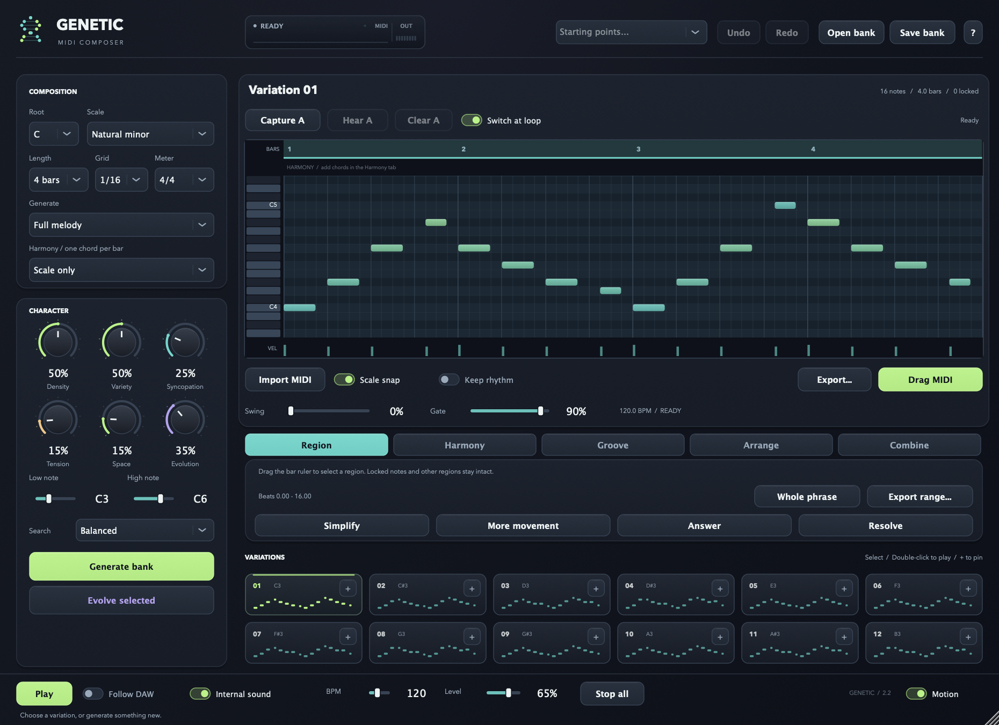

# Genetic Composer 2.2

A JUCE instrument for composing, editing and evolving MIDI phrases. Generate twelve alternatives, keep the interesting parts, develop a motif and take it into your track.

Version **2.2.0** refreshes the native interface with a larger piano roll, note and key activity highlights, animated variation previews, smoother controls and a real MIDI/audio activity display. **Motion** reduces decorative animation while keeping transport and meters visible. The existing parameter IDs and musical controls are unchanged.

Version **2.1.0** introduced local phrase edits, loop-aligned A/B comparison, custom harmony, groove references, four-part arrangements and previews that combine traits from different variations. The **? Help** button opens the built-in guide in Polish or English ([guide preview](images/ui-guide-pl.png)).



[See the native interface during playback](images/ui-motion.gif).

## Make a phrase

1. Load **Genetic Composer** as an instrument. The included sound lets you audition immediately.
2. Choose a scale, phrase length, meter and starting point. **Generate bank** searches for twelve alternatives in the background; **Cancel search** keeps your previous bank.
3. Select a variation and press **Play**, or double-click its card. Turn on **Follow DAW** to follow the host's transport and song position instead.
4. Click **+** on a card to pin it. Pinned variations survive new generations.
5. **Evolve selected** uses the selected phrase as a parent. **Evolution** controls the amount of mutation; **Keep rhythm** preserves all starts and durations.
6. Drag **Drag MIDI** onto an instrument track, or use **Export...**. Export applies swing, gate and scale snapping, and preserves phrase length, meter and velocity. Custom harmony takes priority over scale snapping.

## Develop a phrase in context

The workflow tabs sit next to the piano roll. **Region** operates on the selected part of a phrase; **Harmony** and **Groove** keep references separately from your melody. **Arrange** and **Combine** produce an auditionable draft before changing the bank.

- **Region:** drag across the bar-number ruler to choose a range, or choose **Whole phrase**. **Simplify**, **More movement**, **Answer** and **Resolve** transform unlocked notes whose starts are inside the range. Notes outside it and locked notes are preserved. Use Undo to compare with the previous edit.
- **A/B:** press **Capture A** before editing. **Hear A / Hear B** compares that snapshot with the current variation or draft; **Clear A** removes the reference and its outlines. With **Switch at loop** enabled, selecting another card or changing A/B waits for the next loop boundary. The editing target changes immediately; the playing/queued indicators show what is currently audible. Incoming MIDI keys still trigger immediately at their MIDI timestamps.
- **Harmony:** enter chords with durations in quarter-note beats, for example `Cm:4 Fm:2 G7:2`, then choose **Apply chords**. **Import harmony MIDI** estimates chords from a separate MIDI reference; review and correct the resulting chord text before generating. The chord strip shows the active progression. Custom harmony repeats over the phrase and overrides the built-in progression. **Clear** returns to the selected built-in progression.
- **Groove:** choose **Import groove MIDI** or select a variation and press **Use selected**. Set **Timing** and **Velocity**, then **Apply groove** to the target variation. Timing transfers relative timing deviations; velocity transfers an accent pattern. Locked notes remain unchanged. The velocity lane below the piano roll also supports direct click/drag editing of an unlocked note's velocity.
- **Arrange:** **Preview arrangement** creates A–A′–B–A″ from the selected motif: the original, a developed variant, an answer and a resolving ending. The result is four times the source length. Sources over 32 quarter-note beats or 128 notes are rejected; the final result must also fit 512 notes.
- **Combine:** select source variations for **Rhythm**, **Pitches** and **Accents**, then choose **Preview combination**. Rhythm supplies starts and durations; pitch and accent sources are mapped across that rhythm, including when their note counts differ.

Arrangement and combination drafts can be played and exported immediately. **Keep preview** replaces the selected variation and creates an undo step; **Discard** leaves the committed bank intact. Editing is paused while a draft awaits that decision. Unaccepted drafts are not included in saved banks or DAW project state.

To export one section of an arrangement, select its range on the piano-roll ruler and use **Export range**. The resulting MIDI starts at zero, clips notes crossing the selection boundaries, and preserves the selected duration.

## Edit and bring your own ideas

- Click an empty piano-roll cell to add a note; drag a note to change pitch and time.
- Drag a note's right edge to resize it. Right-click or Delete removes an unlocked note.
- Shift-click or press **L** to lock a note. Locked notes appear in amber and survive evolution unchanged.
- Arrow up/down moves a selected, unlocked note by a semitone. Mouse wheel scrolls the visible pitch range.
- Import or drop a `.mid` / `.midi` file to replace the selected variation. Multiple tracks are merged; polyphonic notes are retained. Import accepts musical tick-based MIDI, up to 512 notes and 128 quarter-note beats. Oversize phrases are reported as truncated.
- **Melody on rhythm** generates pitches on the selected phrase's existing rhythm. **Rhythm only** generates a single-pitch rhythm.
- **Undo / Redo** restores up to 24 document edits, including melody changes, custom harmony and groove references. It does not undo parameter automation or A/B capture.
- **Save bank / Open bank** stores the committed bank, parameters, custom harmony, groove reference and captured A snapshot in a `.genetic` file. The same state is saved inside your DAW project. Playback is deliberately stopped on restore.

## Musical controls

| Control | What it changes |
| --- | --- |
| Density | Preferred note count and length |
| Variety | Pitch movement, diversity and motif repetition |
| Syncopation | Preference for off-beat starts |
| Tension | Chromatic movement and harmonic tension; disable Scale snap to hear chromatic notes |
| Space | Rests and gaps |
| Evolution | Distance from the selected parent phrase |
| Harmony | A repeating, four-bar diatonic progression; custom chords can change anywhere in a bar |
| Swing / Gate | Playback and exported timing; the underlying editable notes remain intact |
| Low / High note | Register for new generation |
| Quick / Balanced / Deep | Population size and number of search generations |

Built-in harmony degrees are interpreted in the selected scale (minor modes produce the corresponding minor-scale chords). Custom chord symbols specify their own root and quality. The simple monitor is for auditioning, not a replacement for a production synthesizer. Turn **Internal sound** off when routing the generated MIDI elsewhere.

Incoming MIDI notes **48–59** hold-trigger the twelve variations. Notes **60–127** transpose the phrase, with 60 as the untransposed reference. Octave names differ between DAWs; these numeric note values are authoritative. Releasing one trigger does not stop another still-held trigger. Follow DAW takes precedence over key-triggered or manual transport. **Stop all / Esc** releases generated notes; turn Follow DAW off to keep playback stopped while the host continues running.

Shortcuts: **Space** play/stop, **Cmd/Ctrl+Z** undo, **Cmd/Ctrl+Shift+Z** redo, **Esc** stop all. Hover over controls for hints or open **? Help** for the chapter-based guide. These are local, built-in instructions and do not require a browser or network connection.

## Studio One / Studio Pro

[Instrukcja instalacji i pracy po polsku](docs/STUDIO_ONE_PL.md).

The VST3 identifies as an **instrument with MIDI output**, so load it from Instruments, not the native Note FX section.

The most direct workflow is to audition a phrase, then drag its MIDI to an instrument track containing your chosen sound. For live routing, create a second instrument track and select Genetic Composer as its instrument MIDI input where your host version exposes it; enable monitoring on the receiving track and disable Internal sound in Genetic Composer. The exact input-menu presentation varies by host version. Drag/export is available independently of live routing.

## Build

Requires a C++17 compiler and CMake 3.22+. JUCE is pinned to **8.0.13**. The root CMake project is the supported build entry point; the old generated Visual Studio files are legacy artifacts.

On macOS, with Apple's Command Line Tools installed:

```sh
./scripts/build-macos.sh
```

The script downloads JUCE and, if needed, CMake into the ignored `.deps` directory. It does not install anything globally. Outputs:

```text
build/GeneticComposer_artefacts/Release/VST3/Genetic Composer.vst3
build/GeneticComposer_artefacts/Release/AU/Genetic Composer.component
build/GeneticComposer_artefacts/Release/Standalone/Genetic Composer.app
```

Copy the VST3 bundle to `~/Library/Audio/Plug-Ins/VST3/` and rescan instruments in Studio One. AU goes in `~/Library/Audio/Plug-Ins/Components/`. Builds use the current machine architecture; a universal macOS build can be requested with `./scripts/build-macos.sh '-DCMAKE_OSX_ARCHITECTURES=arm64;x86_64'`.

On Windows, from a Visual Studio 2022 developer terminal:

```sh
cmake -S . -B build -A x64
cmake --build build --config Release --parallel
ctest --test-dir build -C Release --output-on-failure
```

Supply `-DJUCE_SOURCE_DIR=/path/to/JUCE` to use an existing checkout. A network connection is required on the first configure otherwise. Engine tests can run without JUCE: `cmake -S . -B build-engine -DCOMPOSER_BUILD_PLUGIN=OFF`, then build and run CTest.

## Development and validation

See [architecture and validation](docs/DEVELOPMENT.md). The original research, bibliography and v1 documentation remain in [the legacy document](docs/LEGACY.md). The new instrument has a distinct plugin identifier and does not replace v1 inside old projects (v1 did not serialize its generated melodies).

The source is MIT licensed; JUCE has its own licensing terms. Local builds are development builds. Distribution signing, notarization and host/platform qualification remain release tasks.
