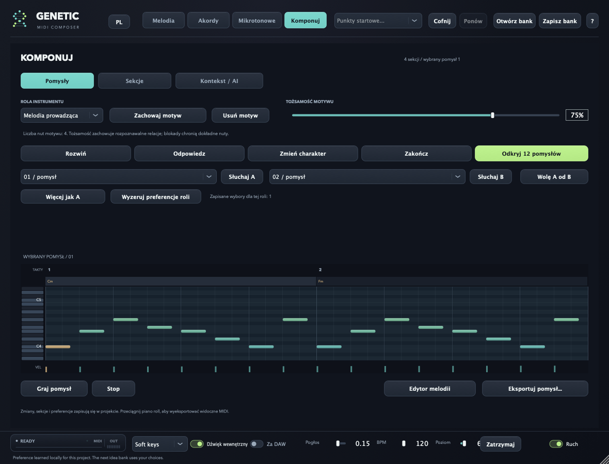
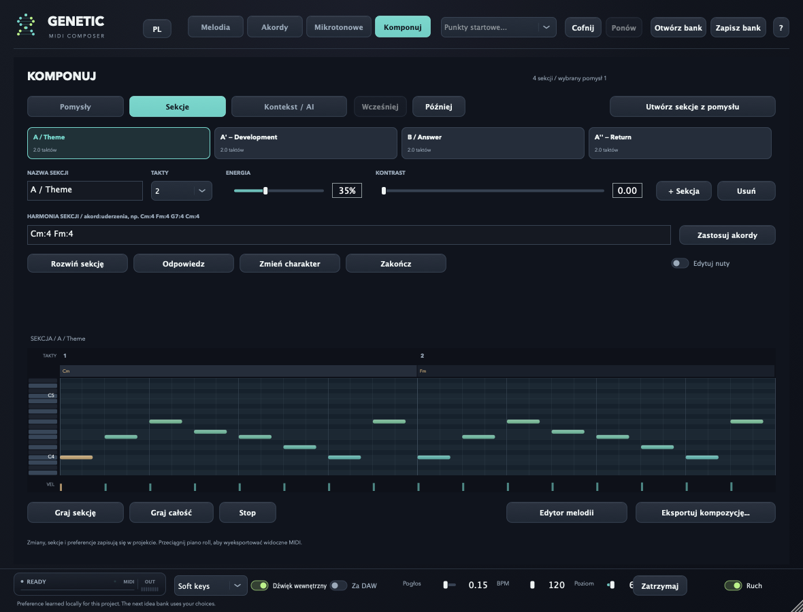

# Compose: from a motif to a composition

**Compose / Komponuj** is the fourth main page. Its Ideas, Sections and Context / AI views work with the conventional Melody bank, including stored microtonal passing notes. The independent Microtonal page keeps its own EDO/ratio pitch representation and workspace.

## Keep an idea and develop it

1. Record, import or generate a useful phrase on Melody, then open Compose. Opening the page preserves an existing conventional audition.
2. On **Ideas / Pomysły**, select the instrument role: Lead, Bass, Riff or Arpeggio. Roles shape the next creative search; choosing a role does not rewrite existing notes.
3. Drag the bar ruler on the Compose piano roll to select the recognisable fragment. This also shares the Melody audition/edit range. **Keep selected motif / Zachowaj motyw** captures note onsets inside that range; without a selection it captures the whole displayed idea.
4. **Motif identity / Tożsamość motywu** controls the preference for related contour and rhythm. It is a musical similarity preference. Exact note locks and Keep rhythm remain the controls for exact preservation.
5. **Develop / Rozwiń**, **Answer / Odpowiedz**, **Contrast / Zmień charakter** and **Finish / Zakończ** transform the selected bank phrase. An existing Melody playback range limits those edits to its unlocked note onsets. Undo restores the previous result.
6. **Explore 12 ideas / Odkryj 12 pomysłów** starts the creative genetic search. The bank labels Development, Response and Contrast describe the returned families. **More like A / Więcej jak A** evolves the A source. Pinned slots survive bank generation.

The remembered motif can guide newly searched phrases even when those phrases have a different register. Capturing a motif enables its identity preference; Clear motif removes that reference. Capturing does not lock notes in the original phrase. Existing locks still retain their exact stored fields.

## Compare and teach the local ranking

Choose two variations in the A and B menus. **Hear A / Słuchaj A** and **Hear B / Słuchaj B** audition those exact bank slots. **Prefer A to B / Wolę A od B** records an explicit comparison and selects A. The comparison count confirms that a choice was stored for the current role.

The next creative search includes the learned ranking together with musical coherence, motif identity, role and context. The small preference model starts without personal examples; each comparison updates its local feature weights. No listening-time or export action is silently treated as a preference. **Reset preferences / Wyzeruj preferencje** clears the current role's comparison count and weights in this project. Ordinary Undo can restore a preceding preference edit.

Lead, Bass, Riff and Arpeggio keep separate preference weights and counts within each project. Preferences, motif and references are saved inside the DAW project and `.genetic` bank. They are project data, not a cloud account or a global profile.

## Build and edit related sections

Open **Sections / Sekcje** and choose **Build sections from idea / Utwórz sekcje z pomysłu**. It creates four related parts: the theme, a development, a contrasting part and a return. Each section stores its own melody, harmony and exact voiced chords. It is independent from the original Melody bank afterward.

- Click a section card to select it. **Earlier / Wcześniej** and **Later / Później** reorder it while keeping its contents.
- Edit its name and bar count. Extending a section repeats its current material in musical time; shortening it crops the end. It does not time-stretch notes. A change that would exceed a section's capacity is reported instead of silently truncating it. Shortening is also rejected if it would truncate or remove an exact locked note.
- Set **Energy / Energia** and **Contrast / Kontrast**, then use one of the section development actions. Those settings guide the next development of that section.
- Enter named chords with quarter-note durations, for example `Cm:4 Fm:4 G7:4 Cm:4`, and choose **Apply chords / Zastosuj akordy**. The chord timeline repeats or crops to the section length. An empty chord field removes that section's harmony. Developing the section then fits its melody to the active chords.
- Enable **Edit notes / Edytuj nuty** for direct piano-roll edits. Shift-click or L retains the existing note-lock interaction.
- **+ Section / + Sekcja** adds the currently selected Melody-bank idea as a new section. **Remove / Usuń** removes the selected section. Both actions support Undo.

Each of up to eight sections can contain up to 512 notes and 128 quarter-note beats, with up to 64 chord events. Sections can have different lengths. Composition playback/export concatenates their timelines without flattening the whole document into a single 512-note clip.

**Play section / Graj sekcję** loops the selected section. **Play all / Graj całość** plays the composition once in section order. **Stop** and the global Stop all/Esc release playback. Space on the Sections page starts/stops the complete composition. Switching back to Melody or Chords preserves the composition audition until another transport action changes it.

**Export composition / Eksportuj kompozycję** writes a type-1 MIDI file with melody and chord tracks, section-name markers, meter and musical metadata. Dragging the section piano roll exports only its displayed melody, starting at zero. The standalone sections remain editable and saved in the project. Melody swing/gate/scale-fit processing follows the existing export rules; voiced chords retain their exact chord timings.

## Use MIDI context and optional local AI

On **Context / AI — Kontekst / AI**, import separate drum and bass MIDI references. They influence new creative proposals and their scoring; they do not become extra audible tracks. **Context influence / Wpływ kontekstu** sets how strongly the generator responds. Clear removes a reference without touching the melody or sections.

The local AI source is experimental and optional. **AI environment / Środowisko AI** selects a prepared local Python runtime, and **Generate AI ideas / Generuj pomysły AI** requests a MIDI proposal that is developed by the native engine. A runtime path restored from a project is a chooser hint, not permission to execute that file: choose the prepared runtime again when required, or use the independently configured default local runtime. Setup and the real inference checks are documented in [AI_MIDI.md](AI_MIDI.md). Normal plugin generation/playback requires no network connection. Cancel stops a running AI request; failure leaves the previous bank intact.

## A short composing session

Capture two beats of a recorded riff, explore a bank and choose a useful development. Compare that against a response and record the preferred version. Build the four sections, shorten the opening, raise the energy of the middle section, give it a different chord sequence and develop it once. Audition the transitions, edit the ending, then export the composition's MIDI to production instruments.

## Po polsku

W karcie **Komponuj** zacznij od **Pomysłów**: wybierz rolę, zaznacz charakterystyczny fragment na linijce piano rolla i kliknij **Zachowaj motyw**. **Tożsamość motywu** określa podobieństwo rytmu i konturu; dokładne nuty zabezpieczają blokady. Cztery działania rozwijają frazę, tworzą odpowiedź, kontrast albo zakończenie. **Odkryj 12 pomysłów** uruchamia bank rozwinięć, odpowiedzi i kontrastów.

Porównuj konkretne warianty przez **Słuchaj A / Słuchaj B**. **Wolę A od B** zapisuje wybór dla kolejnych wyszukiwań tego projektu, a **Więcej jak A** rozwija wybrany pomysł. Każda rola ma osobne preferencje w tym projekcie. Wyzerowanie dotyczy bieżącej roli i można je cofnąć przez Undo.

W **Sekcjach** utwórz cztery części z pomysłu, a potem zmieniaj każdą niezależnie: nazwę, długość, energię, kontrast, akordy oraz nuty. Energia i kontrast dotyczą następnego rozwinięcia. **Zastosuj akordy** zmienia harmonię; **Rozwiń sekcję** dopasowuje do niej melodię. Dłuższa sekcja powtarza swój materiał, krótsza przycina koniec. Skrócenie, które uszkodziłoby zablokowaną nutę, zostaje odrzucone. **Wcześniej / Później** przestawia części bez utraty ich zawartości.

**Graj sekcję** zapętla wybraną część, **Graj całość** odtwarza kompozycję jeden raz. Eksport kompozycji zapisuje osobne ścieżki melodii i akordów z nazwami sekcji. Przeciągnięcie piano rolla daje tylko widoczną melodię sekcji. Zmiany, źródła MIDI, sekcje i wyuczone preferencje zachowuje projekt DAW oraz bank `.genetic`.

W **Kontekst / AI** dodasz referencje MIDI perkusji i basu. Wpływają na nowe propozycje, bez dokładania słyszalnych ścieżek. Opcjonalne lokalne AI wymaga jednorazowego przygotowania środowiska według [AI_MIDI.md](AI_MIDI.md); zwykły silnik genetyczny działa samodzielnie. Ścieżka interpretera odczytana z projektu jest tylko podpowiedzią do wyboru środowiska i nie uruchamia automatycznie tego pliku.
